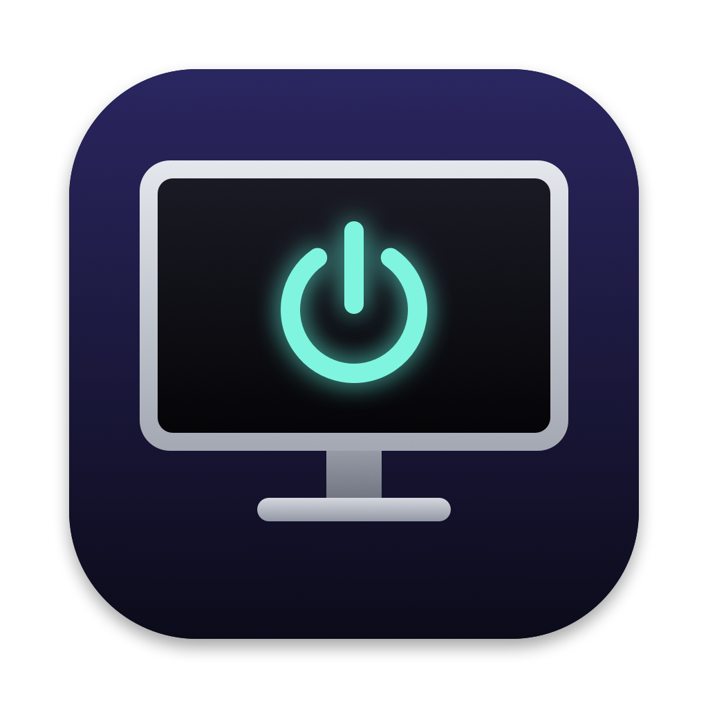

# ScreenOff

Menu bar app and CLI for turning individual displays off on macOS. No backlight, no power cut.

[Website](https://screenoff.pawels-apps.workers.dev) · [Download](https://github.com/pawisoon/ScreenOff/releases/latest) · [Sponsor](https://github.com/sponsors/pawisoon)

ScreenOff software-disconnects a display: macOS stops sending it a signal, so the monitor drops into its own power-saving mode. This works on any monitor, including ones without DDC power control (Apple Studio Display, built-in panels) and ones that fall off the bus when powered off over DDC (some LG UltraFine models).

While a display is off, macOS treats it as unplugged, so windows move to your other screens and come back when it is turned on again. Mouse movement does not wake it; use the menu or `screenoff on`.

Only the video signal stops. The monitor stays powered, so USB-C Power Delivery keeps charging your Mac and the monitor's Thunderbolt and USB ports keep working. Turning a monitor off with its power button or over DDC usually cuts those too.

## Install

Download the DMG from [Releases](https://github.com/pawisoon/ScreenOff/releases/latest) and drag ScreenOff to Applications.

To build from source instead you need macOS 14+ and the Swift toolchain (Xcode or Command Line Tools):

```bash
./scripts/install.sh
```

This builds `ScreenOff.app`, copies it to `/Applications`, links `screenoff` into `/opt/homebrew/bin` (or `/usr/local/bin`), and launches it.

Remove with `./scripts/uninstall.sh`.

## Menu bar

- Toggle each display on/off (the last active display can't be turned off).
- Turn off all external displays / turn everything back on.
- Speaker volume slider for monitors that support DDC volume (e.g. LG over HDMI/DisplayPort, where macOS greys out the volume control).
- Sleep all displays (same as `pmset displaysleepnow`).
- Launch at login.

Quitting the app turns every display it disabled back on.

## CLI

```
screenoff list                 # show displays and state
screenoff off lg               # name match is case-insensitive, any part
screenoff off lg studio        # several at once
screenoff on                   # everything back on
screenoff toggle 3             # by ID from `list`
screenoff sleep                # sleep all displays
screenoff volume lg            # monitor speaker volume over DDC
screenoff volume lg 40         # set (also +10 / -10)
```

The CLI and the menu bar app share state (`~/Library/Application Support/ScreenOff/disabled.json`), so either can turn back on what the other turned off.

## Development

```bash
swift build
swift test
.build/debug/ScreenOff list
./scripts/build-app.sh         # -> build/ScreenOff.app
swift scripts/make-icon.swift  # regenerate Resources/AppIcon.icns
```

The website is the static page in `docs/`. GitHub Pages serves it from `main`, and `npx wrangler deploy` publishes it to Cloudflare.

## Release

Builds a universal, Developer ID-signed, notarized DMG and publishes it as a GitHub release tagged from `CFBundleShortVersionString`.

```bash
# one-time: store notarization credentials (app-specific password from appleid.apple.com)
xcrun notarytool store-credentials ScreenOff --apple-id <apple-id> --team-id 297W77MNZY

./scripts/release.sh
```

`SKIP_NOTARIZE=1 PUBLISH=0 ./scripts/release.sh` builds and signs the DMG locally without notarizing or publishing.

Not App Store eligible: there is no public API for disabling a display.

## Notes

Display control uses the private `CGSConfigureDisplayEnabled` (SkyLight), resolved at runtime.

## License

MIT
